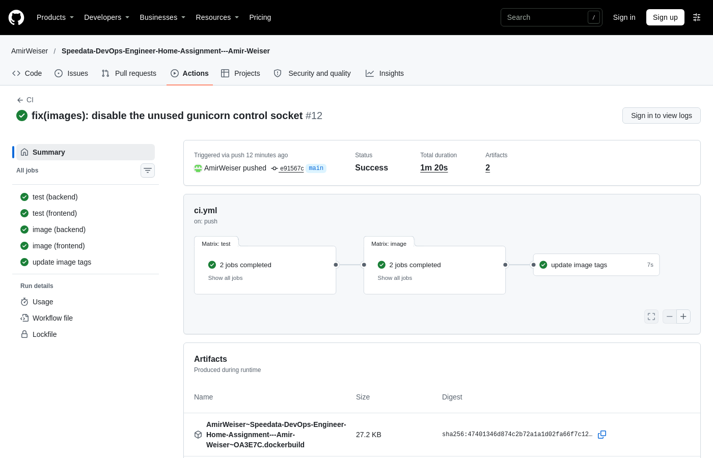
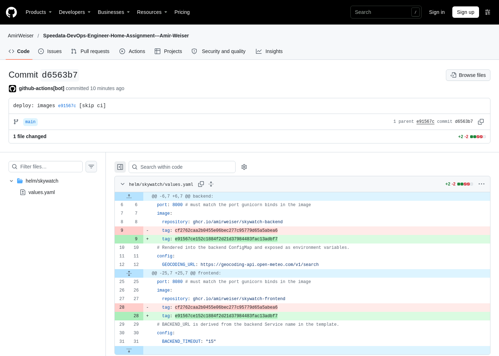
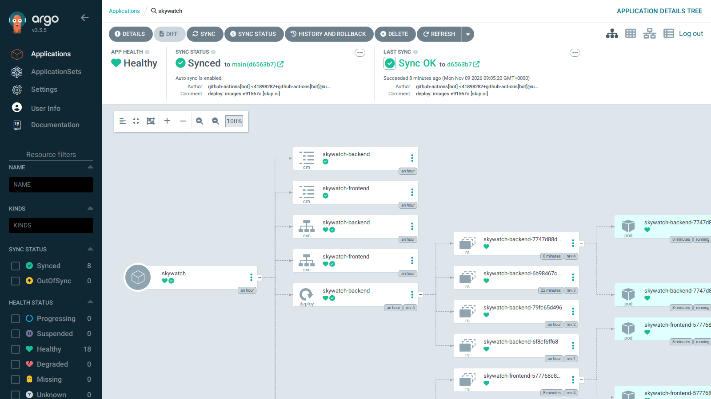
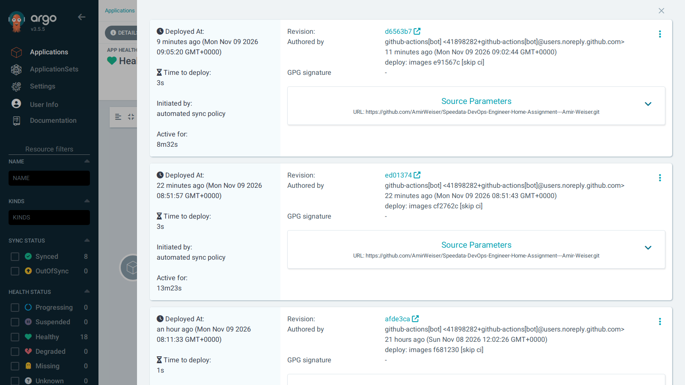
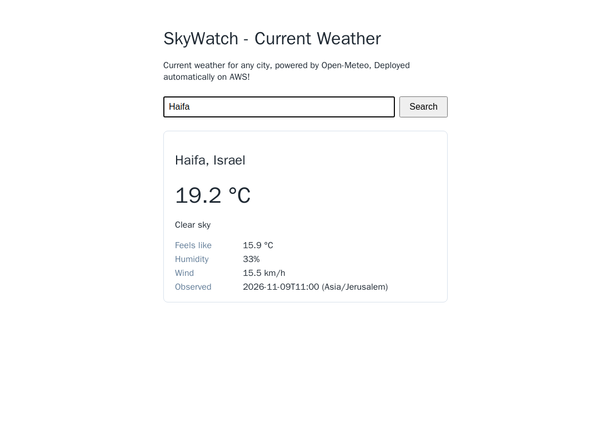

# SkyWatch: DevOps Home Assignment (SpeedData)

A small weather-query app (Flask frontend -> Flask backend -> Open-Meteo), built, shipped and run with
Terraform, Ansible, K3s, Helm, GitHub Actions, GHCR and ArgoCD.

> **Status:** complete. The same chart and Argo CD Application run on two clusters: a local k3d cluster and a
> three-node K3s cluster on AWS EC2. Both were validated end to end, including a push to `main` rolling out through
> CI and Argo CD with zero failed requests. Evidence: [docs/gitops-evidence.md](docs/gitops-evidence.md) and the
> [screenshots below](#proof-of-the-gitops-flow).

## Chosen path: hybrid

| | Local (Path B, reduced) | AWS (Path A topology + Terraform/AWS bonus) |
|---|---|---|
| Cluster | k3d from [`infra/local/k3d.yaml`](infra/local/k3d.yaml) | 3 EC2 Ubuntu 24.04 instances from Terraform ([`infra/aws`](infra/aws)) |
| Nodes | 1 tainted server + 2 agents (containers) | `skywatch-cp` (tainted) + `skywatch-worker-1/2` |
| K3s install | k3d (`rancher/k3s:v1.37.2-k3s1`) | Ansible roles ([`ansible/`](ansible)), pinned `v1.37.2+k3s1`, idempotent |
| App access | `http://localhost:8081` | `http://<worker-public-ip>:30080`, allowed only from your IP |
| Deployment | Argo CD, same Application, same chart, same `main` | same |

The laptop (Windows, WSL2) cannot comfortably run three Ubuntu VMs, so the reduced path runs locally and the full
Path A topology (3 Ubuntu machines, K3s installed by Ansible) runs on EC2 instead of Multipass VMs. Both clusters follow
`main`, so one push deploys to both. See [ADR-001](docs/decisions.md).

## Workstation prerequisites

All tooling runs inside **WSL2 Ubuntu 24.04** ([ADR-002](docs/decisions.md)), with the repository on the Linux
filesystem. Docker is provided by Docker Desktop's WSL integration.

| Tool | Version |
|---|---|
| Terraform | 1.17.1 |
| ansible-core | 2.21.6 |
| kubectl | v1.37 |
| Helm | v4.3.1 |
| AWS CLI | v2 |
| gh, git, Python 3.12, Docker | current |

**Secret scanning:** enable the repository's pre-commit hook once per clone. It runs
[gitleaks](https://github.com/gitleaks/gitleaks) (pinned image) on the staged changes and blocks the commit on a finding.

```bash
git config core.hooksPath .githooks
```

## Application

```
Browser ──GET /?city=Haifa──▶ frontend :8080 ──GET /api/weather?city=Haifa──▶ backend :8000 ──▶ Open-Meteo
                              (HTML page)        BACKEND_URL                   (JSON API)       geocoding + forecast
```

| Service | Endpoints | Configuration (env) |
|---|---|---|
| backend | `GET /api/weather?city=` → 200 / 400 invalid input / 404 unknown city / 502 upstream error / 504 upstream timeout; `GET /healthz` | `GEOCODING_URL`, `FORECAST_URL`, `UPSTREAM_CONNECT_TIMEOUT` (2), `UPSTREAM_READ_TIMEOUT` (4) |
| frontend | `GET /` (form), `GET /?city=` (result or error page); `GET /healthz` | `BACKEND_URL` (`http://localhost:8000`), `BACKEND_TIMEOUT` (15) |

`/healthz` never calls a dependency ([ADR-004](docs/decisions.md)). Errors are JSON `{"error": "..."}` on the
backend and a friendly message on the frontend; internal details are logged, not returned.

### Run locally

```bash
docker compose up --build        # http://localhost:8080
docker compose down
```

The backend has no published port (internal only, as in Kubernetes). Containers run as UID 10001 with a
read-only root filesystem and all capabilities dropped.

### Tests and lint

```bash
python3 -m venv .venv
.venv/bin/pip install --require-hashes -r app/backend/requirements.txt
.venv/bin/pip install --require-hashes -r app/frontend/requirements.txt
.venv/bin/pip install -r requirements-dev.txt

.venv/bin/ruff check app && .venv/bin/ruff format --check app
(cd app/backend && ../../.venv/bin/python -m pytest)
(cd app/frontend && ../../.venv/bin/python -m pytest)
```

Tests run per service (`python -m pytest` from the service directory) because both services have an `app`
module.

### Updating dependencies

Edit `requirements.in`, then regenerate the hash-locked `requirements.txt` in the same image the service runs on:

```bash
cd app/backend   # or app/frontend
docker run --rm --user "$(id -u):$(id -g)" -e HOME=/tmp -v "$PWD:/w" -w /w python:3.12-slim-trixie sh -c \
  'pip install -q --user pip-tools==7.6.2 && /tmp/.local/bin/pip-compile -q --generate-hashes --strip-extras --no-emit-index-url -o requirements.txt requirements.in'
```

## CI: GitHub Actions -> GHCR

Workflows: [`ci.yml`](.github/workflows/ci.yml) (app) and [`chart.yml`](.github/workflows/chart.yml) (Helm lint).

```
test (backend, frontend)     image (backend, frontend)                    update image tags (push to main)
  ruff lint + format check     build once -> image.tar                      verify both SHA tags exist in GHCR
  pytest                       Trivy: vulnerabilities + Dockerfile config   write SHA into helm/skywatch/values.yaml
                               smoke test: read-only, /healthz, UID 10001   (forward-only), commit + push
                               [push to main] skopeo push, verify digest    -> Argo CD deploys it
```

| Event | `ci.yml` | `chart.yml` |
|---|---|---|
| Pull request to `main` | Always (tests, build, scan, smoke; publishes nothing) | Always |
| Push to `main` changing application code or workflows | Full run: publish images + update Helm tags | If chart/Argo CD files changed |
| Push to `main` changing only `docs/**`, `**.md`, `helm/**`, `argocd/**`, `infra/**`, `ansible/**`, `scripts/**`, `.githooks/**` | Skipped (images unaffected) | If chart/Argo CD files changed |
| CI's own tag commit (`deploy: images <sha> [skip ci]`) | Not triggered (pushed with `GITHUB_TOKEN`) | Not triggered |

Note: a commit message containing `[skip ci]` anywhere skips every workflow for that push.

Images: `ghcr.io/amirweiser/skywatch-backend` and `ghcr.io/amirweiser/skywatch-frontend`, tagged with the
**full commit SHA** (no `latest`). The run summary records the tag and the digest. An existing SHA tag is never
overwritten. Design rationale: [ADR-007](docs/decisions.md).

## Kubernetes: Helm chart

Chart: [`helm/skywatch`](helm/skywatch). Design rationale: [ADR-008](docs/decisions.md).

```
NodePort 30080 ─▶ Service skywatch-frontend ─▶ frontend (2 pods, one per worker)
                                                  │ BACKEND_URL=http://skywatch-backend:8000 (ConfigMap)
                  Service skywatch-backend  ◀─────┘ ClusterIP, internal only
                          │
                  backend (2 pods, one per worker) ─▶ Open-Meteo
```

| Resource | Purpose |
|---|---|
| `backend-deployment`, `frontend-deployment` | Probes on `/healthz`, requests/limits, restricted security context, `preStop` sleep, `maxUnavailable: 0` |
| `backend-service` (ClusterIP), `frontend-service` (NodePort) | Backend is internal only; frontend is reachable from the host |
| `backend-configmap`, `frontend-configmap` | App settings as env vars; a `checksum/config` annotation rolls pods when they change |
| `backend-pdb`, `frontend-pdb` | A node drain always leaves one pod of each component serving |
| `tests/test-connection` | `helm test` for manual Helm installs (Argo CD does not run Helm test hooks) |

Render or lint locally without a cluster: `helm template skywatch helm/skywatch -n skywatch`,
`helm lint --strict helm/skywatch`.

### Secrets: none in Git

| Secret | Where it lives |
|---|---|
| App credentials | None needed (Open-Meteo has no API key); ConfigMaps hold only non-sensitive settings |
| CI registry access | The workflow's short-lived `GITHUB_TOKEN`; no repository secrets are stored |
| Argo CD admin password | Generated in the cluster (`argocd-initial-admin-secret`), never written to Git |
| K3s join token | Generated on the control plane; Ansible holds it in memory only (`no_log`) |
| kubeconfig, SSH private key, Terraform state | On the operator machine only (git-ignored; kubeconfig mode `0600`); Terraform receives only the public key |

A gitleaks pre-commit hook blocks commits containing secrets. A real secret (for example a Grafana password) would be
added as a Sealed Secret or through External Secrets, so Git only ever holds encrypted data or a reference.

## GitOps: Argo CD

Git is the only deployment interface. CI never talks to the cluster; it records in Git which images to run.

```
developer push (app code) ─▶ CI: test ─▶ build/scan/smoke ─▶ publish to GHCR ─▶ commit SHA into values.yaml
                                                                                        │
cluster ◀── rolling update ◀── Argo CD auto-sync (polls main every ~2-3 min) ◀───────────┘
```

| Piece | What it does |
|---|---|
| [`scripts/bootstrap-argocd.sh`](scripts/bootstrap-argocd.sh) | One-time, idempotent: installs Argo CD (chart 10.10.5 = v3.5.5, [`argocd/values.yaml`](argocd/values.yaml)) and applies the Application |
| [`argocd/skywatch-application.yaml`](argocd/skywatch-application.yaml) | Deploys `helm/skywatch` from `main`; automated sync with **prune** and **self-heal**; creates the namespace with the `restricted` Pod Security label |
| `update image tags` job in `ci.yml` | After both images are published, commits the commit SHA into `values.yaml` (never moves backwards) |

Design rationale and trade-offs: [ADR-009](docs/decisions.md). Evidence: [docs/gitops-evidence.md](docs/gitops-evidence.md).

### Bring up the local environment from scratch

[`infra/local/k3d.yaml`](infra/local/k3d.yaml) mirrors the AWS topology: 1 tainted control plane + 2 workers,
K3s v1.37.2, Traefik disabled, images pulled from GHCR. Requires Docker, k3d v5.9+, kubectl and Helm.

```bash
k3d cluster create --config infra/local/k3d.yaml
scripts/bootstrap-argocd.sh          # waits until the app is Synced and Healthy (~5 min on a laptop)
# App: http://localhost:8081/?city=Haifa   (8081 so it never collides with docker compose on 8080)
k3d cluster delete skywatch          # tear down
```

### Day-to-day workflow

1. Change application code, push to `main` (or open a PR first: it runs every check without publishing).
2. CI publishes images and pushes `deploy: images <sha> [skip ci]` to `main`. **Run `git pull` before your next
   commit**, since CI now commits too.
3. Argo CD rolls the cluster forward within a few minutes. Rollback = `git revert` the tag commit.

Never `kubectl edit`/`helm upgrade` managed resources: self-heal reverts manual changes within seconds.

### Inspecting Argo CD and the deployment

```bash
kubectl -n argocd get application skywatch                     # SYNC STATUS / HEALTH STATUS
kubectl -n argocd get application skywatch -o jsonpath='{.status.operationState.phase} {.status.operationState.syncResult.revision}{"\n"}'
kubectl -n argocd port-forward svc/argocd-server 8443:443      # UI: https://localhost:8443 (self-signed cert), user admin
kubectl -n argocd get secret argocd-initial-admin-secret -o jsonpath='{.data.password}' | base64 -d; echo
kubectl get nodes                                              # server tainted, 2 workers
kubectl -n skywatch get pods -o wide                           # one frontend + one backend per worker
kubectl -n skywatch get deploy -o custom-columns='NAME:.metadata.name,IMAGE:.spec.template.spec.containers[0].image'
kubectl -n skywatch get svc,endpointslices,pdb
kubectl -n skywatch top pods
kubectl -n skywatch logs -l app.kubernetes.io/name=backend -f  # access logs from both replicas
```

## AWS: Terraform + Ansible

> **Status: deployed and validated on AWS** (2026-11-09): 26 resources from one `terraform apply`, 3 nodes Ready,
> Argo CD Synced/Healthy, app served on both workers, a second Ansible run reported `changed=0 failed=0` on every host,
> and two GitOps rollouts completed with 0 failed requests. Details: [GitOps evidence, section 7](docs/gitops-evidence.md#7-aws-deployment-2026-11-09).

```
                   your IP (/32) ── SSH 22, K8s API 6443 ──┐        app_cidrs ── HTTP 30080 ──┐
                                                           ▼                                   ▼
┌─ VPC 10.20.0.0/16 ── public subnet 10.20.1.0/24 (one AZ) ── Internet Gateway ─────────────────────────┐
│  skywatch-cp        t3.small   K3s server, tainted NoSchedule (no app pods)                           │
│  skywatch-worker-1  t3.medium  K3s agent: Argo CD + SkyWatch (one replica of each component per worker)│
│  skywatch-worker-2  t3.medium  K3s agent                                                              │
│  node-to-node: only 6443/tcp, 8472/udp (flannel VXLAN), 10250/tcp (kubelet); outbound: 80/443 only    │
└────────────────────────────────────────────────────────────────────────────────────────────────────────┘
```

| Decision | Choice | Main alternative and why not |
|---|---|---|
| Subnets | One public subnet, inbound controlled by security groups | Private subnets need a NAT Gateway (~$0.045/h + data) for GHCR/GitHub/Open-Meteo, more than both workers |
| Public IPs | On all 3 nodes ($0.005/h each) | NAT instance on the control plane saves $0.01/h but adds a single point of failure and iptables config |
| Admin access | SSH, key-only, `admin_cidr` (validated, never `0.0.0.0/0`) | SSM Session Manager removes port 22 but Ansible over SSM needs an S3 bucket, a plugin and an IAM role |
| Node IAM | **No instance profile**; IMDSv2 required, hop limit 1 | Nothing on the nodes calls AWS APIs, so there are no credentials to steal |
| App exposure | NodePort 30080 on workers from `app_cidrs` (default your IP) | ALB (~$0.0225/h + LCU) is unnecessary for one service |
| Kubernetes API | 6443 from `admin_cidr`; `tls-san` = control-plane public IP | SSH tunnel is stricter but less convenient |
| Sizing | t3.small + 2x t3.medium (variables) | 3x t3.small fits today (Argo CD 171Mi, app 193Mi measured) but leaves no room for the monitoring/autoscaling bonuses; changing type later restarts instances and changes public IPs |
| Storage | 20 GiB encrypted gp3 root per node, deleted with the instance | The app is stateless; no extra volumes |
| AMI | Latest Canonical Ubuntu 24.04, `ignore_changes = [ami]` | Without the ignore, a new AMI would replace the cluster on the next apply |

### Responsibilities

| Layer | Owns |
|---|---|
| Terraform (`infra/aws`) | VPC, subnet, routing, security groups, key pair (public half only), instances, generated Ansible inventory; runs Ansible via one `terraform_data` |
| Ansible (`ansible/`) | K3s server + agents from `/etc/rancher/k3s/config.yaml` (pinned v1.37.2+k3s1, never uninstalls), readiness checks, kubeconfig export, Argo CD bootstrap via `scripts/bootstrap-argocd.sh` |
| Argo CD | Everything in the cluster after bootstrap, from Git (same Application as the local cluster) |

### Cost (us-east-1 on-demand, from the AWS Price List API)

| Item | Rate | Per hour |
|---|---|---|
| 1x t3.small + 2x t3.medium | $0.0208 + 2 x $0.0416 | $0.1040 |
| 3 public IPv4 addresses | $0.005 each | $0.0150 |
| 3 x 20 GiB gp3 | $0.08/GB-month | $0.0066 |
| **Total** | | **~$0.126/h** (~$3/day, ~$92/month if left running) |

Not included: internet egress (small; AWS includes 100 GB/month free), T3 surplus CPU credits ($0.05/vCPU-hour, only
when sustained above baseline). No NAT Gateway, load balancer, Elastic IP or CloudWatch charges. **Destroy after use.**

### Prerequisites

- WSL/Linux with Terraform >= 1.10, ansible-core, kubectl, Helm (see Workstation prerequisites), AWS CLI credentials.
- IAM permissions: EC2 only (VPC, subnet, internet gateway, route table, security groups and rules, key pair import,
  instances, image and AZ lookups, tags). No IAM, S3 or other services are used. Prefer a dedicated deployer user over
  an administrator, for example:

  ```json
  {
    "Version": "2012-10-17",
    "Statement": [
      { "Sid": "Ec2InProjectRegion", "Effect": "Allow", "Action": "ec2:*", "Resource": "*",
        "Condition": { "StringEquals": { "aws:RequestedRegion": "us-east-1" } } },
      { "Sid": "ReadOnlyChecks", "Effect": "Allow",
        "Action": ["sts:GetCallerIdentity", "tag:GetResources", "pricing:GetProducts"], "Resource": "*" }
    ]
  }
  ```

  This still allows any EC2 action in the region (including on unrelated instances); tighter scoping with tag
  conditions is possible but much longer.
- An SSH key pair: `ssh-keygen -t ed25519 -f ~/.ssh/skywatch_ed25519 -C skywatch-admin`
  (with a passphrase, run `ssh-add ~/.ssh/skywatch_ed25519` first; Ansible runs non-interactively).

### Provision (one command after init)

```bash
cd infra/aws
terraform init
terraform plan -var "admin_cidr=$(curl -s https://checkip.amazonaws.com)/32" -out tfplan   # review: 26 to add
terraform apply tfplan     # AWS resources, then Ansible: K3s server -> agents -> readiness -> kubeconfig -> Argo CD
```

`-var run_ansible=false` creates the infrastructure only; then run `cd ansible && ansible-playbook site.yml`.
Re-running the playbook is safe (idempotent); Terraform re-runs it when instances, public IPs or the Ansible/Argo CD
files change. If your public IP changes, `terraform apply` with the new `admin_cidr` updates only the security groups.

### Verify

```bash
export KUBECONFIG=$(git rev-parse --show-toplevel)/kubeconfig-aws    # written by Ansible, mode 0600, git-ignored
kubectl get nodes -o wide                         # 3 Ready; skywatch-cp has the control-plane taint
kubectl -n argocd get application skywatch        # Synced / Healthy
kubectl -n skywatch get pods -o wide              # one frontend + one backend on each worker
terraform -chdir=infra/aws output app_urls        # open http://<worker-ip>:30080/?city=Haifa
(cd ansible && ansible-playbook site.yml)         # second run: expect changed=0
kubectl top nodes && kubectl -n skywatch top pods # metrics-server ships with K3s
```

### GitOps on AWS

The AWS cluster runs the same Argo CD Application as the local cluster: both follow `helm/skywatch` on `main`. A push
to `main` goes through CI, CI commits the new image tag, and Argo CD rolls out the change on every cluster that runs it.
No credentials for the AWS cluster exist outside your machine.

### Recovery

| Situation | What happens / what to do |
|---|---|
| Ansible (bootstrap) fails during `apply` | Instances and network stay; only `terraform_data.bootstrap` is marked tainted. Fix the cause, then `terraform apply` again (re-runs only the playbook) or `cd ansible && ansible-playbook site.yml`. The playbook is idempotent; Argo CD install retries transient chart-download errors. |
| Your public IP changed | `terraform apply -var admin_cidr=<new>/32` updates only the security groups. |
| An instance got a new public IP (stop/start) | `terraform apply` re-runs the playbook (trigger includes public IPs): new `tls-san`, new kubeconfig. |
| A worker must be replaced | `terraform apply -replace='aws_instance.node["skywatch-worker-1"]'`. The playbook removes the old Node and its K3s node-password secret before the new machine joins under the same name; Argo CD reschedules the pods. |
| The control plane is lost | Single server = cluster state lost. Rebuild: `terraform destroy` + `terraform apply` (~10-15 min); Argo CD restores the app from Git. |

### Tear down

```bash
cd infra/aws
terraform destroy -var "admin_cidr=$(curl -s https://checkip.amazonaws.com)/32"   # also deletes kubeconfig-aws and the known_hosts file
aws resourcegroupstaggingapi get-resources --region us-east-1 --tag-filters Key=Project,Values=skywatch \
  --query 'ResourceTagMappingList[].ResourceARN'      # expect [] (terminated instances may be listed for ~1 hour; they are not billed)
aws ec2 describe-instances --region us-east-1 --filters Name=tag:Project,Values=skywatch \
  Name=instance-state-name,Values=pending,running,stopping,stopped --query 'Reservations[].Instances[].InstanceId'   # expect []
```

Nothing inside Kubernetes creates AWS resources (no load balancer controller, no EBS CSI), so `terraform destroy` removes
everything that costs money.

### Known limitations and production improvements

| Area | Here | Production |
|---|---|---|
| Availability | 1 control plane (K3s SQLite datastore), 1 AZ | 3 servers with embedded etcd across AZs; workers in multiple AZs |
| Network | Public subnet + public IPs; egress 80/443 to anywhere (Trivy AWS-0104, accepted) | Private subnets + NAT, egress proxy or Network Firewall, VPC Flow Logs (Trivy AWS-0178) |
| Access | SSH from one IP; trust-on-first-use host keys | SSM Session Manager, no inbound admin ports |
| Ingress | NodePort over HTTP | Ingress controller + ALB/NLB, TLS (cert-manager), DNS |
| State | Local Terraform state | S3 backend with state locking, per-environment workspaces |
| Secrets | K3s token and kubeconfig only on nodes / local `0600` file | K3s secrets encryption, external secrets manager, short-lived credentials |
| Operations | Ubuntu unattended security updates (no automatic reboot) | Patch/reboot automation (kured), backups of the datastore |

## Proof of the GitOps flow

Commit `e91567c` (a Dockerfile change) on AWS, with no manual `kubectl` or `helm` command. Full timeline:
[docs/gitops-evidence.md](docs/gitops-evidence.md#7-aws-deployment-2026-11-09).

1. CI run: tests, image build/scan/publish, `update image tags` (84 s).

   
2. CI's tag commit `d6563b7`: a two-line change to `helm/skywatch/values.yaml`, `[skip ci]`, no workflow triggered.

   
3. Argo CD (AWS cluster) synced `d6563b7` automatically; the history also shows the previous automated rollout
   (`ed01374`, image `cf2762c`, a frontend change).

   
   
4. The application served from a worker's public IP (the page subtitle is the `cf2762c` change).

   

## Problems and improvements

- Problems encountered and their fixes: [docs/problems.md](docs/problems.md).
- With more time: the "Production" column in [Known limitations](#known-limitations-and-production-improvements),
  plus the observability bonus (Prometheus/Grafana with request metrics), an Ingress with TLS, and an HPA.

## Documentation

- [Architecture decisions](docs/decisions.md)
- [Problems and solutions](docs/problems.md)
- [CI evidence](docs/ci-evidence.md), [GitOps evidence](docs/gitops-evidence.md)
